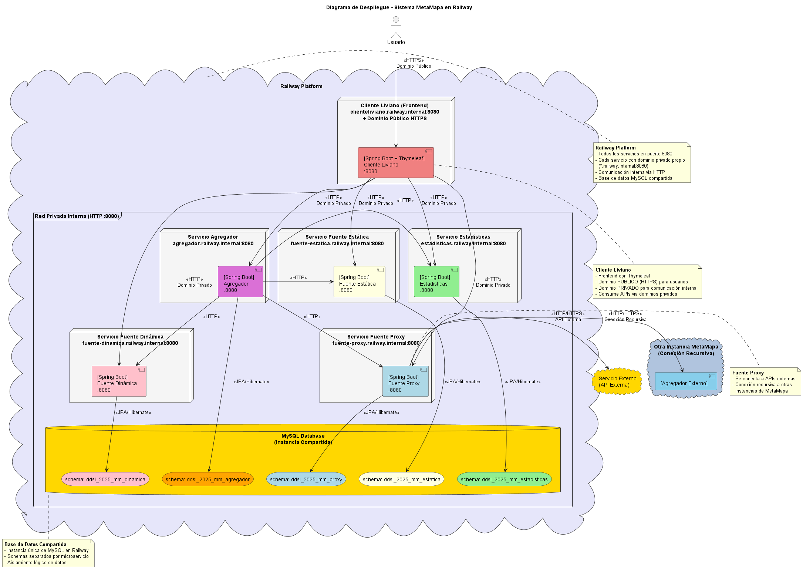
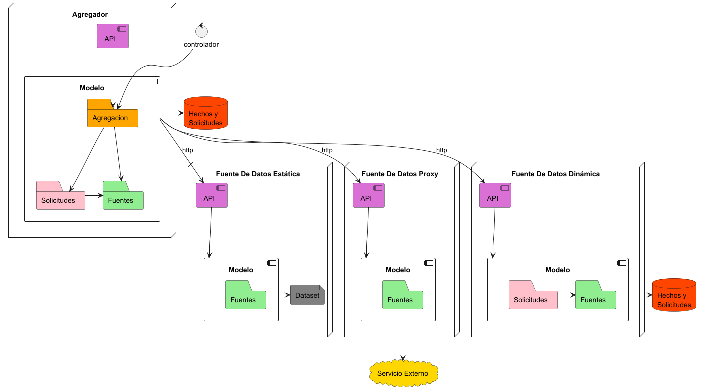
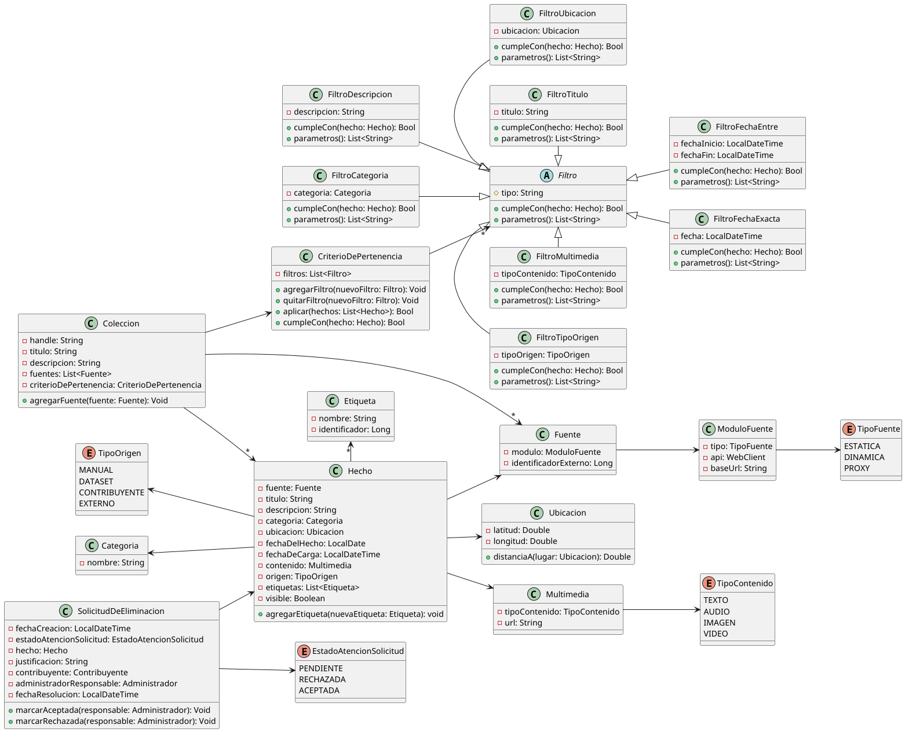

# Metamapa – Distributed Geographical Data Aggregator

Plataforma de agregación de datos geolocalizados basada en una arquitectura de **Microservicios**. Diseñada en Java 17 para unificar asíncronamente eventos ("hechos") desde fuentes estáticas, aportes dinámicos y consumo de APIs de terceros.

## 📑 Índice
- [El Problema y la Motivación](#problema)
- [Tech Stack y Arquitectura](#tech-stack)
- [Features Clave](#features)
- [Calidad de Código y Delivery](#delivery)
- [Aprendizajes Clave y Roadmap](#aprendizajes)
- [Visuales, Diagramas y Documentación Anexa](#visuales)
- [Instalación y Ejecución Local](#instalacion)

<a name="problema"></a>
## 🧠 El Problema y la Motivación

Los sistemas modernos de mapas comunitarios o monitoreo de eventos (como rastreadores de desastres naturales) lidian con una ingesta de información sumamente fragmentada. Los datos pueden provenir de *datasets* gubernamentales (CSV/JSON), reportes manuales de usuarios en tiempo real, o integraciones B2B con otros sistemas.

El desafío arquitectónico consistió en construir un sistema que consolide estas fuentes heterogéneas sin generar un monolito rígidamente acoplado. La solución fue desacoplar el sistema en microservicios independientes, orquestados mediante contenedores y gobernados por patrones de diseño sólidos que permiten inyectar nuevas estrategias de filtrado sin alterar la lógica de negocio central.

<a name="tech-stack"></a>
## 🏗️ Tech Stack y Arquitectura

*   **Lenguaje y Framework:** Construido íntegramente en **Java 17**, estructurado como un proyecto Multimódulo de Maven, garantizando la separación estricta de dominios lógicos.
*   **Core Backend (Stateless Microservices):** La solución se divide en nodos autónomos y sin estado (`Agregador` orquestador, `Estadísticas` y `Fuentes` de ingesta estática, dinámica y proxy). Al no guardar estado en memoria, la arquitectura garantiza escalabilidad horizontal nativa y alta tolerancia a fallos.
*   **Capa de Presentación (Stateful Client):** Interfaz de usuario (Cliente Liviano) renderizada del lado del servidor (SSR) empleando **Thymeleaf**. Gestiona el estado de las sesiones activas mediante **Spring Security** y delega asíncronamente el procesamiento al backend stateless a través de `WebFlux` (WebClient).
*   **Persistencia Distribuida:** Uso de bases de datos relacionales particionadas lógicamente (**MySQL**) inyectadas dinámicamente a través de variables de entorno de Spring Boot.
*   **Infraestructura en Contenedores:** Todo el ciclo de vida de la red, los volúmenes de persistencia y el levantamiento concurrente de los servicios está definido declarativamente a través de **Docker Compose**.

<a name="features"></a>
## ⚡ Features Clave

*   **Ingesta de Red Paralelizada:** El servicio `Fuente Proxy` implementa concurrencia y multithreading para consumir páginas de APIs REST de terceros (ej. "Desastres Naturales API") de forma simultánea, maximizando drásticamente el *throughput* de importación.
*   **Patrones de Diseño Estructurales y de Comportamiento:** Uso extensivo del patrón *Strategy* para implementar lectores agnósticos (CSV, texto plano, JSON) y una evaluación dinámica de criterios de filtrado. Esto respeta el principio *Open/Closed*.
*   **Geoprocesamiento Espacial Integrado:** Implementación matemática nativa de la *Fórmula de Haversine* para procesar consultas geoespaciales, filtrando hechos que ocurran estrictamente dentro de un radio en kilómetros de un punto específico (Lat/Long).
*   **Cliente Liviano Interactivo y Seguro (Stateful):** Aplicación web (Server-Side Rendered) que consolida la vista geográfica, administra de forma segura la sesión del usuario (Stateful) e implementa un riguroso Control de Acceso Basado en Roles (RBAC con roles de Contribuyente y Administrador).
*   **Máquina de Estados de Auditoría:** Un ciclo de vida inmutable aplicado al control de moderación (Aceptación/Rechazo de solicitudes de contribuyentes), garantizando trazabilidad total.

<a name="delivery"></a>
## 🚀 Calidad de Código y Delivery

Los servicios del backend se validan con Maven:
* **Testing:** La suite de pruebas de integración se basa en **JUnit 5**, verificando la correcta comunicación entre los módulos.
* **Static Analysis:** `mvn clean verify` ejecuta revisiones automatizadas de formateo con **Checkstyle**, análisis estático con **SpotBugs** y verificación de cobertura con **JaCoCo**.

<a name="aprendizajes"></a>
## 📈 Aprendizajes Clave y Roadmap

*   **Desacoplamiento vs Latencia de Red:** Dividir la lógica en 5 servicios independientes solucionó el acoplamiento pero introdujo retos de comunicación asíncrona; lo cual requirió el diseño de *Healthchecks* estrictos y políticas de reconexión (*retries*) a nivel contenedor en Docker Compose.
*   **Diseño Orientado al Dominio (DDD):** Encapsular variables primitivas dentro de *Value Objects* enriquecidos (por ejemplo, envolver coordenadas y lógicas de cálculo dentro de la clase `Ubicacion`) mejoró sustancialmente la cohesión interna frente a las validaciones aisladas.

<a name="visuales"></a>
## 🖼️ Visuales, Diagramas y Documentación Anexa

<div align="center">
  <h4>Diagrama de Despliegue (Infraestructura Cloud)</h4>
  
  <br><br>
  <h4>Arquitectura de Microservicios</h4>
  
  <br><br>
  <h4>Diagrama de Clases (Módulo Agregador)</h4>
  
</div>

### 📄 Documentación Anexa de Ingeniería
* [**Justificaciones de Diseño (Justificaciones.txt)**](./Justificaciones.txt): Documento técnico profundo detallando el racional detrás de la elección de los patrones de diseño (Strategy), el modelado de jerarquías de usuarios y el manejo de los enums en el dominio.
* [**Boceto de Prototipado (PDF)**](./docs/exportados/Boceto.pdf): Conceptualización visual original y mockups de experiencia de usuario.
* El repositorio incluye una suite completa de diagramas adicionales (Casos de Uso, Clases modulares, despliegue físico) en la carpeta `docs/exportados/`.

<a name="instalacion"></a>
## ⚙️ Instalación y Ejecución Local

Toda la infraestructura (Redes, Volúmenes y microservicios) está paquetizada para ser orquestada fácilmente.

### Pre-requisitos
* Java 17 SDK (Si se desea ejecutar validaciones por consola).
* Docker y Docker Compose instalados.

### Comandos de Ejecución

```bash
# 1. Clonar el repositorio
git clone https://github.com/tsorren/Metamapa-TP-DDSI.git
cd Metamapa-TP-DDSI

# 2. Validar la calidad del código, checkstyle y ejecutar la suite de Tests
# (Opcional, pero recomendado para comprobar sanidad)
./mvnw clean verify

# 3. Levantar la granja de microservicios e infraestructura
docker-compose up --build -d
```

Los servicios se inicializarán y quedarán expuestos (tras superar sus *Healthchecks* internos) en los puertos `8080` a `8084`.
